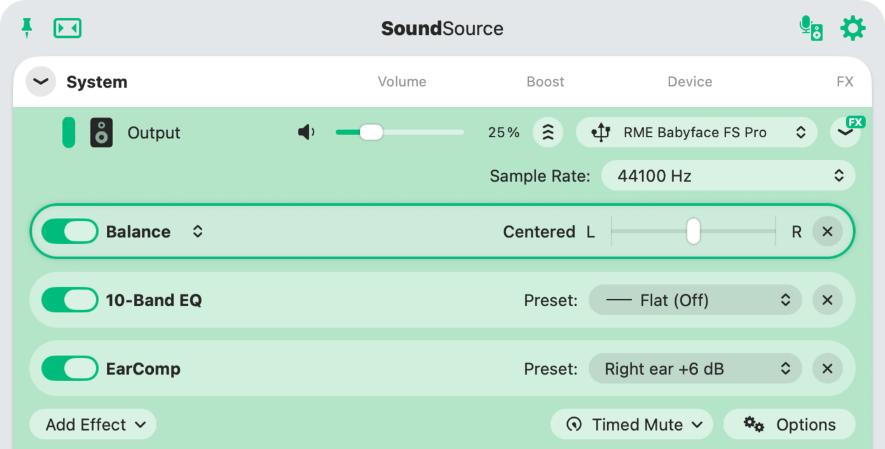

# EarComp

An Audio Unit for macOS that applies my Mimi hearing profile to everything the Mac plays,
and gives my weaker right ear a bit more treble.



## Why I built this

I have tinnitus in my right ear, which is also my weaker ear. I took Mimi's hearing test with my
Focal Bathys (it is built into the Focal & Naim app), and Mimi's sound personalization did a very
nice job, on the Bathys and on my Audio-Technica ATH-R70x.

At my desk I listen on a HiFiMAN Edition XV plugged into an RME Babyface Pro FS. On the Mac,
Mimi only exists as a Chrome extension, so the personalization only reached browser tabs.
Music apps, Live, my synth plugins and everything else played without it.

The interface couldn't fill the gap either. TotalMix on the Babyface has a 3-band EQ per output
(I use it for the headphone's own correction) but no compressor, and an RME compressor would
not help anyway: it works on the whole signal at once, while Mimi treats each frequency range
separately.

So I measured what Mimi actually does with my profile and rebuilt it as an Audio Unit.
[SoundSource](https://rogueamoeba.com/soundsource/) runs it on the Babyface output,
so all system audio gets it.

While doing that I also found that Mimi's presets process both ears identically, even though
the test measures each ear separately. Since my right ear is the weaker one, EarComp has a
**Right ear treble** control that adds treble on the right channel only.

## What Mimi does (measured)

I loaded my profile and ran test signals through Mimi's processing:
- sine tones at 25 frequencies (63 Hz to 16 kHz) and 19 levels (−90 to 0 dBFS),
  for each of its three settings (Recommended, Richer, Softer)
- level steps, to see how fast it reacts
- pink noise, to see how neighbouring frequencies affect each other

It turned out to be a gentle multiband compressor:
- **Quiet sounds get boosted, loud ones barely or not at all.** Ratios are between 1.04 and 1.38.
  Near full scale it cuts, presumably to avoid clipping.
- **Most of the boost is in the treble,** with a smaller lift in the low mids. Gain added with
  the Recommended setting:

  | Input level | 125 Hz | 250 Hz | 1 kHz | 4 kHz | 8 kHz | 12.5 kHz | 16 kHz |
  |---|---|---|---|---|---|---|---|
  | quiet (−60 dBFS) | +7.2 | +8.3 | +1.1 | +5.3 | +9.9 | +17.9 | 0 |
  | medium (−30 dBFS) | +4.2 | +5.0 | −0.2 | +2.4 | +5.1 | +10.3 | 0 |
  | full scale (0 dBFS) | −1.4 | −2.1 | −3.4 | −7.3 | −7.8 | −9.1 | 0 |

- **Both channels always get the same gain,** set by the average of the two channels' levels.
- **It reacts in about 50 ms** and settles within about 200 ms, in both directions.
- **Richer and Softer have the same shape** at roughly 1.4× and 0.5× the strength.
- **The intensity slider is a plain dry/wet blend.**

The full measurements are in [`data/mimi-map.json`](data/mimi-map.json). They come from my
profile, so EarComp as published is tuned to my ears. The measuring harness is not included
because it relies on Mimi's own code.

## How EarComp works

- It splits the audio into short overlapping FFT frames (256 samples, hop 64, the same frame
  size Mimi uses). That gives a fixed delay of 256 samples, about 5.8 ms at 44.1 kHz.
- For every frequency bin it measures the level around it (±1.5 octaves, at least ±2 bins),
  smooths it over about 50 ms, and averages the two channels in dB the way Mimi does.
- It looks up the gain in the measured tables (`src/MimiTables.h`) and applies it.
- **Right ear treble** (0 to 12 dB) is then added on the right channel. It fades in from
  3 kHz, is at full strength from 5 kHz to 12.5 kHz, and fades out by 16 kHz, where Mimi
  stops processing.

Controls: **Intensity** (0–100 %), **Variant** (Recommended, Richer, Softer),
**Right ear treble** (0–12 dB). Presets: *Mimi match*, *Right ear +6 dB*, *Right ear +10 dB*.

### How close it gets

`make check` runs the same measurements on EarComp and compares them with Mimi's:
- **Steady tones:** 0.3 dB average error, worst 1.3 dB (at 63 Hz)
- **Pink noise:** about 0.5 dB average error. EarComp gives up to about 1 dB more treble
  around 8 kHz.
- **Reaction speed:** within a few tenths of a dB at every point after a level step

## Building and installing

You need macOS on Apple Silicon and Xcode.

```sh
git clone --recursive https://github.com/mchibouni/earcomp.git
cd earcomp
make            # build/EarComp.component and build/probe
make check      # compare against the Mimi measurements
make install    # copy to ~/Library/Audio/Plug-Ins/Components and run auval
```

The Makefile uses Xcode's toolchain on purpose: on macOS 27 the Command Line Tools linker
can't read the SDK's library stubs.

In SoundSource, click **Add Effect** on your output device and pick **EarComp → EarComp**.
If you also use Mimi's Chrome extension, turn it off, otherwise browser audio is processed twice.

## Notes

- This is a personal listening tool, not a medical device or a hearing aid.
- Not affiliated with Mimi Hearing Technologies.
- Built on Apple's [AudioUnitSDK](https://github.com/apple/AudioUnitSDK) (Apache 2.0),
  included as a submodule.
- MIT license, see [LICENSE](LICENSE).
